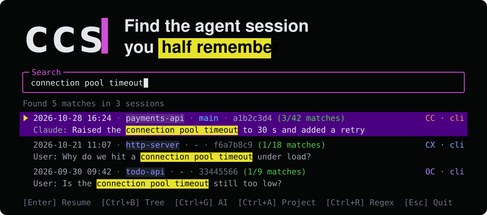
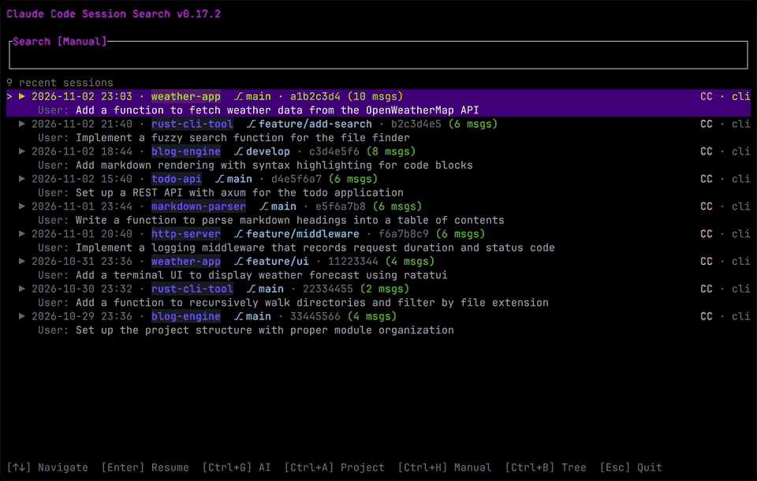
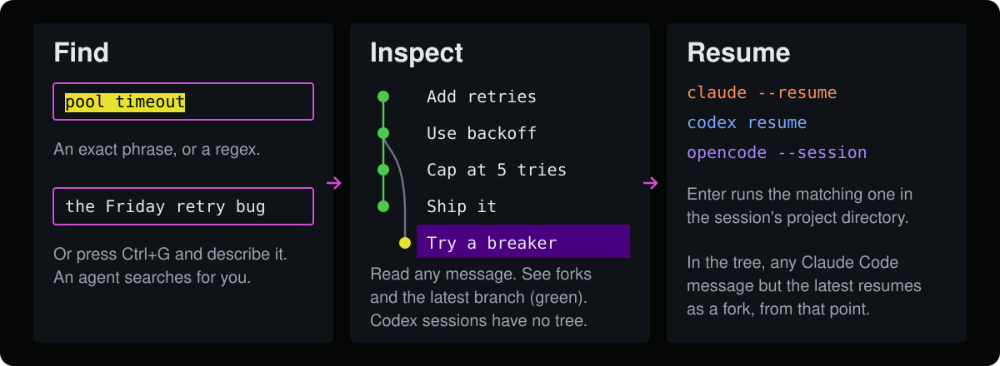

<h1 align="center">
  
</h1>

<p align="center">
  <a href="https://crates.io/crates/ccfullsearch"></a>
  <a href="https://github.com/materkey/ccfullsearch/blob/main/LICENSE"></a>
  <a href="https://github.com/materkey/ccfullsearch/actions/workflows/ci.yml"></a>
</p>

Search, inspect, and resume local Claude Code, Claude Desktop, Codex, and Opencode sessions from the terminal.

Use `ccs` when you remember a topic, command, file path, stack trace, or decision from an old agent session, but not the session itself.

<p align="center">
  
</p>

## Install

```bash
brew install materkey/ccs/ccs
```

<details>
<summary>Shell installer, Cargo, cargo-binstall</summary>

The crate and the installer are named `ccfullsearch`; the installed command is `ccs`.

Shell installer:

```bash
curl --proto '=https' --tlsv1.2 -LsSf https://github.com/materkey/ccfullsearch/releases/latest/download/ccfullsearch-installer.sh | sh
```

Cargo:

```bash
cargo install ccfullsearch --locked
```

cargo-binstall:

```bash
cargo binstall ccfullsearch
```

Update a non-Homebrew install with `ccs update`. For Homebrew installs, use `brew upgrade ccs` instead.

</details>

Requirements:

- `rg` from [ripgrep](https://github.com/BurntSushi/ripgrep) must be available in `PATH`. The Homebrew formula installs it automatically.
- `claude` must be available in `PATH` to resume Claude Code sessions and to use AI search.
- `codex` must be available in `PATH` to resume Codex sessions.
- `opencode` must be available in `PATH` to resume Opencode sessions.

## Quick start

```bash
ccs
```

`ccs` opens on recent sessions. Start typing to search. Press `Enter` to resume the selected session.

Opened the wrong session? Leave it within a minute (`/exit` or `Ctrl+C`) and `ccs` comes back exactly where you were: the same query, filters and cursor, with the session you just opened tagged `[opened]`. Leaving after a longer session returns to the shell as before.

If Claude, Codex or Opencode fails to start the session, `ccs` shows the error; press `Enter` to return to the picker.

## How it works

<p align="center">
  
</p>

- **Full transcripts, not titles.** `ccs` searches user and assistant messages, tool calls and tool results, thinking blocks, image, document and attachment references, rendered slash commands, and project, branch, provider, source, timestamp and message count metadata. Results are grouped by transcript, so multiple matches from the same conversation stay together.
- **Resume a Claude Code session from any point.** Tree view shows conversation branches, fork points, latest-chain markers, and compaction boundaries. Resuming from a non-latest tree message creates a forked JSONL transcript and resumes that branch. Opencode sessions always open at their latest point, Codex sessions have no tree, and for Claude Desktop sessions `Enter` only opens the app on macOS.
- **Search by description.** Press `Ctrl+G` and describe the session in your own words, in any language. A `claude -p` agent tries several phrasings over your whole history and returns up to five sessions, each with a short reason.
- **Other machines too.** With [remote hosts](https://github.com/materkey/ccfullsearch/blob/main/docs/remote-hosts.md) configured, search, recent sessions, preview, tree and resume work over ssh next to your local sessions.

## Main keys

| Key | Action |
| --- | --- |
| `Up` / `Down` | Move through sessions or messages |
| `Enter` | Resume the selected session or tree message |
| `Tab` / `Ctrl+V` | Show or hide the preview pane |
| `Ctrl+B` | Open the conversation tree |
| `Ctrl+G` | Find a session by describing it (AI search) |
| `Ctrl+A` | Toggle current-project filtering |
| `Ctrl+H` | Switch between manual, automated, and all sessions |
| `Ctrl+R` | Toggle regex search |
| `Ctrl+C` | Clear the current query, or quit when the query is empty |
| `Esc` | Close preview or quit |

The rest is in the [TUI guide](https://github.com/materkey/ccfullsearch/blob/main/docs/tui.md): expanding results, tree view keys, the AI search config, text editing keys and the host filter.

## From scripts and agents

```bash
ccs search "docker build" --limit 10            # JSONL matches
ccs search "OOM|OutOfMemory" --regex --limit 20
ccs show /path/to/session.jsonl --line 381      # messages around a match
ccs list --limit 20                             # recent sessions as JSONL
ccs pick "docker" --output /tmp/choice.txt      # interactive picker, writes the choice to a file
```

Output fields are in the [CLI reference](https://github.com/materkey/ccfullsearch/blob/main/docs/cli.md). It also covers `--tree`, `--resume-uuid` and overlay mode: `ccs --overlay` keeps the picker open after a session ends.

## What it searches

`ccs` reads local transcripts. By default it uses the session roots that exist on your machine:

| Tool | Location | Override |
| --- | --- | --- |
| Claude Code CLI | `~/.claude/projects/` | `$CLAUDE_CONFIG_DIR/projects/` |
| Codex | `~/.codex/sessions/` and `~/.codex/archived_sessions/` | `$CODEX_HOME/sessions/` and `$CODEX_HOME/archived_sessions/` |
| Claude Desktop on macOS | `~/Library/Application Support/Claude/local-agent-mode-sessions/` | |
| Claude Desktop on Linux | `~/.config/Claude/local-agent-mode-sessions/` | |
| Opencode on Linux/XDG | `~/.local/share/opencode/opencode.db` | `$OPENCODE_DATA/opencode.db` or `$XDG_DATA_HOME/opencode/opencode.db` |
| Opencode on macOS | `~/Library/Application Support/opencode/opencode.db` | `$OPENCODE_DATA/opencode.db` or `$XDG_DATA_HOME/opencode/opencode.db` |

To replace the default roots with one custom directory:

```bash
CCFS_SEARCH_PATH=/custom/sessions/dir ccs
```

## Claude Code plugin

The repository includes a Claude Code plugin in `.claude-plugin/` and a `ccs` skill in `.claude/skills/ccs/`, so Claude Code can find where a topic was discussed, list recent sessions, and resume a previous conversation.

```bash
# Add the marketplace
claude plugin marketplace add materkey/ccfullsearch

# Install the plugin
claude plugin install ccs@ccfullsearch
```

Alternatively, install just the skill with [skills](https://github.com/vercel-labs/skills):

```bash
npx skills add materkey/ccfullsearch --skill ccs
```

Add `-g` to install globally (user-level) instead of into the current project.

The skill supports:

- CLI mode through `ccs search` and `ccs list`.
- Overlay picker mode through `.claude/skills/ccs/scripts/launch-ccs.sh`.
- Overlay resume through `.claude/skills/ccs/scripts/launch-resume.sh`.

## More

- [TUI guide](https://github.com/materkey/ccfullsearch/blob/main/docs/tui.md)
- [CLI reference](https://github.com/materkey/ccfullsearch/blob/main/docs/cli.md)
- [Remote hosts](https://github.com/materkey/ccfullsearch/blob/main/docs/remote-hosts.md)
- [Use cases](https://github.com/materkey/ccfullsearch/blob/main/docs/use-cases.md)
- [Changelog](https://github.com/materkey/ccfullsearch/blob/main/CHANGELOG.md)
- [Contributing and release](https://github.com/materkey/ccfullsearch/blob/main/CONTRIBUTING.md)

## License

MIT
