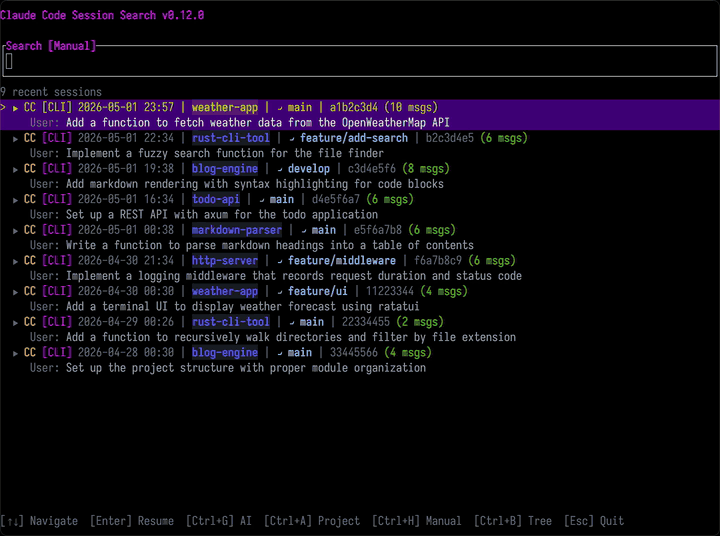

# ccs

[](https://github.com/materkey/ccfullsearch/actions/workflows/ci.yml)

Search, inspect, and resume local Claude Code, Claude Desktop, Codex, and Opencode sessions from the terminal.

Use `ccs` when you remember a topic, command, file path, stack trace, or decision from an old agent session, but not the session itself.



## Install

The package is named `ccfullsearch`; the installed command is `ccs`.

Homebrew:

```bash
brew install materkey/ccs/ccs
```

Shell installer:

```bash
curl --proto '=https' --tlsv1.2 -LsSf https://github.com/materkey/ccfullsearch/releases/latest/download/ccfullsearch-installer.sh | sh
```

Cargo:

```bash
cargo install ccfullsearch --locked
```

cargo-binstall:

```bash
cargo binstall ccfullsearch
```

Requirements:

- `rg` from [ripgrep](https://github.com/BurntSushi/ripgrep) must be available in `PATH`. The Homebrew formula installs it automatically.
- `claude` must be available in `PATH` to resume Claude Code sessions and to use AI search.
- `codex` must be available in `PATH` to resume Codex sessions.
- `opencode` must be available in `PATH` to resume Opencode sessions.

## Claude Code plugin

The repository includes a Claude Code plugin in `.claude-plugin/` and a `ccs` skill in `.claude/skills/ccs/`.

Install the plugin via the Claude Code plugin marketplace:

```bash
# Add the marketplace
claude plugin marketplace add materkey/ccfullsearch

# Install the plugin
claude plugin install ccs@ccfullsearch
```

Alternatively, install just the skill with [skills](https://github.com/vercel-labs/skills):

```bash
npx skills add materkey/ccfullsearch --skill ccs
```

Add `-g` to install globally (user-level) instead of into the current project.

The skill supports:

- CLI mode through `ccs search` and `ccs list`.
- Overlay picker mode through `.claude/skills/ccs/scripts/launch-ccs.sh`.
- Overlay resume through `.claude/skills/ccs/scripts/launch-resume.sh`.

With the plugin installed, Claude Code can use `ccs` for requests such as:

- find where a topic was discussed;
- list recent sessions;
- resume a previous conversation.

## Quick start

Open the TUI:

```bash
ccs
```

Start typing to search. Press `Enter` to resume the selected session.

Opened the wrong session? Leave it within a minute (`/exit` or `Ctrl+C`) and `ccs` comes back exactly where you were: the same query, filters and cursor, with the session you just opened tagged `[opened]`. Leaving after a longer session returns to the shell as before.

If Claude, Codex or Opencode fails to start the session, `ccs` shows the error; press `Enter` to return to the picker.

Search from the CLI:

```bash
ccs search "docker build" --limit 10
ccs search "OOM|OutOfMemory" --regex --limit 20
```

List recent sessions:

```bash
ccs list --limit 20
```

Pick a session for a script:

```bash
ccs pick "docker"
```

Keep the picker open after resuming a session:

```bash
ccs --overlay
```

Open the tree view directly:

```bash
ccs --tree <session-id-or-path>
```

Resume from a specific message UUID:

```bash
ccs --overlay --tree /path/to/session.jsonl --resume-uuid <message-uuid>
```

Update a non-Homebrew install:

```bash
ccs update
```

For Homebrew installs, use `brew upgrade ccs` instead.

## What it searches

`ccs` reads local JSONL transcripts. By default it uses the session roots that exist on your machine:

- Claude Code CLI: `~/.claude/projects/`
- Claude Code CLI with a custom config directory: `$CLAUDE_CONFIG_DIR/projects/`
- Codex: `~/.codex/sessions/` and `~/.codex/archived_sessions/`
- Codex with a custom home: `$CODEX_HOME/sessions/` and `$CODEX_HOME/archived_sessions/`
- Claude Desktop on macOS: `~/Library/Application Support/Claude/local-agent-mode-sessions/`
- Claude Desktop on Linux: `~/.config/Claude/local-agent-mode-sessions/`
- Opencode on Linux/XDG: `~/.local/share/opencode/opencode.db`
- Opencode on macOS: `~/Library/Application Support/opencode/opencode.db`
- Opencode with a custom data directory: `$OPENCODE_DATA/opencode.db` or `$XDG_DATA_HOME/opencode/opencode.db`

To replace the default roots with one custom directory:

```bash
CCFS_SEARCH_PATH=/custom/sessions/dir ccs
```

## What gets indexed

`ccs` searches across transcript content and useful session metadata:

- user and assistant messages;
- tool calls and tool results;
- thinking blocks;
- image, document, and attachment references;
- rendered slash commands;
- project, branch, provider, source, timestamp, and message count metadata.

Results are grouped by transcript, so multiple matches from the same conversation stay together.

## TUI

`ccs` opens on recent sessions. Type anything to switch into search mode.

Main keys:

- `Up` / `Down`: move through sessions or messages.
- `Enter`: resume the selected session or selected tree message.
- `Tab` / `Ctrl+V`: show or hide the preview pane.
- `Ctrl+B`: open the conversation tree.
- `Ctrl+A`: toggle current-project filtering.
- `Ctrl+H`: switch between manual, automated, and all sessions.
- `Ctrl+L`: switch between all machines, this machine, remote machines and each remote host (only with remote hosts configured, see [Remote hosts](#remote-hosts)).
- `Ctrl+R`: toggle regex search.
- `Ctrl+G`: find a session across the whole history by describing it (AI search).
- `Ctrl+C`: clear the current query, or quit when the query is empty.
- `Esc`: close preview or quit.

Text editing also supports `Home`, `End` / `Ctrl+E`, `Delete`, `Ctrl+W`, `Alt+Backspace`, `Alt+D`, `Alt+B` / `Alt+Left`, `Alt+F` / `Alt+Right`, and `Ctrl+Left` / `Ctrl+Right`.

### Tree view

Tree view shows conversation branches, fork points, latest-chain markers, and compaction boundaries.

For Claude Code sessions, resuming from a non-latest tree message creates a forked JSONL transcript and resumes that branch. This lets you continue from the exact point you selected instead of the latest leaf.

Useful keys in tree view:

- `Left` / `Right`: jump to the previous or next branch point.
- `Tab`: toggle message preview.
- `Enter`: resume from the selected message.
- `Ctrl+C`, `b`, or `Esc`: return to search.
- `q`: quit.

### AI search

Press `Ctrl+G`, describe the session in your own words (any language), then press `Enter`. `ccs` starts `claude -p` as a search agent over your whole history, not only the sessions on screen. The agent may only run `ccs search` and `ccs show`; it tries several phrasings and returns up to five sessions, each with a short reason.

A search takes about half a minute. While it runs, the status bar shows the queries the agent is trying, and `Esc` stops it. In the results, `Enter` opens a session at its latest point, `→` or `Ctrl+B` opens its tree, typing edits the query, and `Esc` returns to the list you came from.

The agent runs with lean flags (haiku by default, no MCP servers, plugins or settings, `--no-session-persistence`), so searches do not add sessions to your history.

### Configuration

`ccs` reads `$XDG_CONFIG_HOME/ccs/config.toml`, or `~/.config/ccs/config.toml` when `XDG_CONFIG_HOME` is not set (macOS included). The file is optional:

```toml
[agent_search]
model = "claude-haiku-5-5"   # optional, this is the default
effort = "medium"            # optional: low | medium | high | xhigh | max; not passed by default
```

The file is read on every `Ctrl+G` search, so edits apply without restarting `ccs`. A typo inside `[agent_search]` or an unknown `effort` value is shown in the status bar instead of starting the search. The model name is not checked: an error from `claude` is shown as is.

## CLI

`ccs search` writes JSONL, one `{"type":"match",...}` object per matching message.

Fields:

- `type`: always `match` on result rows.
- `host`: `local`, or the remote host the session lives on (see [Remote hosts](#remote-hosts)).
- `session_id`: session UUID or provider-specific session ID.
- `project`: project name extracted from the transcript path or metadata.
- `provider`: transcript owner, for example `Claude` or `Codex`.
- `source`: session source, for example `CLI` or `Desktop`.
- `file_path`: full path to the JSONL transcript (for Opencode: `<db>#<session_id>`).
- `line_number`: 1-based line of the message in the JSONL transcript; `null` for Opencode, whose messages live in SQLite.
- `message_uuid`: message UUID when the transcript has one; for Opencode this is the SQLite message id.
- `timestamp`: message timestamp in RFC 3339 format.
- `role`: message role.
- `content`: snippet around the match (about 200 characters of context on each side). Pass `--full-content` to output the entire message text instead.

The last line is always a summary record, even with zero matches, so consumers can tell whether the result set is complete:

```json
{"type":"summary","shown":100,"total_matches":2721,"sessions":24,"truncated":true}
```

- `shown`: number of result lines emitted.
- `total_matches`: matches found before applying `--limit`.
- `sessions`: distinct sessions among the shown results.
- `truncated`: `true` when results are incomplete (the limit cut them off or a per-file match cap was hit).

Example:

```bash
ccs search "connection pool timeout" --regex --limit 10
```

`ccs show` prints the messages around a search hit — the drill-down step after `ccs search`. Pass `file_path` plus `--line` (the `line_number` of a match) or `--uuid` (its `message_uuid`; the only valid anchor for Opencode):

```bash
ccs show /path/to/session.jsonl --line 381 --context 3 --max-chars 2000
ccs show "/path/to/opencode.db#ses_abc" --uuid msg_123
```

Without `--line` and `--uuid` it prints the end of the session: the last `--tail` messages (default 10) of its current line — the latest branch of a Claude session. The target can also be a session id instead of a path; for a Codex thread that is its current rollout file:

```bash
ccs show 01a178da-2e05-7720-b6ba-6b4edd17fc27 --tail 10
```

Output is JSONL: `{"type":"message",...}` rows in file order, then a final `{"type":"summary",...}`. Message fields: `file_path`, `line_number`, `message_uuid`, `parent_uuid`, `role`, `timestamp`, `content`, plus `is_target: true` on the anchor row and `content_truncated: true` when `--max-chars` (default 2000) cut the content. `--context` (default 3) counts messages on each side; interleaved non-message records do not shrink the window. Near a fork of a branched session the window follows file order, not the chain — use `parent_uuid` to see the actual structure. In tail mode the summary has `"mode": "tail"` and `total_messages`.

Codex keeps a reverted or forked thread in a new rollout file that points at a prefix of an earlier one (`session_meta.history_base`) instead of copying it. `ccs` reads such a session as that prefix plus the file's own records: `list`, message counts, `show` and `--tail` cover the whole history, and a `show` row whose `file_path` differs from the summary's comes from the inherited part. A reverted thread shows up once, as its newest rollout.

`ccs list` writes JSONL, one object per recent session.

Fields:

- `session_id`
- `project`
- `provider`
- `source`
- `file_path`
- `last_active`
- `message_count`

Example:

```bash
ccs list --limit 20
```

## Picker mode

`ccs pick` opens the same TUI, but prints the selected session as key-value output. It exits with code `0` after a selection and `1` on cancel.

```bash
ccs pick
ccs pick "docker"
ccs pick --output /tmp/session.txt
```

Example output:

```text
session_id: abc-123
file_path: /path/to/session.jsonl
source: CLI
project: my-project
message_uuid: def-456
```

`message_uuid` is included when the selected row maps to a concrete message, such as a search result or tree selection.

## Remote hosts

`ccs` can search other machines over ssh next to this one. List them as `[[hosts]]` in `~/.config/ccs/config.toml` (`$XDG_CONFIG_HOME/ccs/config.toml`, the same path on macOS):

```toml
[[hosts]]
name = "Z270XX"

[[hosts]]
name = "devbox"
ccs_path = "/home/me/.cargo/bin/ccs"
```

`name` is an ssh alias: address, user, key and ControlMaster come from `~/.ssh/config`. Each host needs the same `ccs` version installed; `ccs_path` points at it when it is not on the PATH of a non-interactive ssh shell. `ccs` connects with `ssh -o BatchMode=yes`, so it never asks for a password: key-based login must work without a prompt.

- Search and recent sessions cover every host by default. Results from this machine show at once; a host's results join the list when they arrive, and a host that is down never delays the rest. The status line shows each host: `Z270XX: 37`, `Z270XX: …` (waiting), `Z270XX: недоступен (reason)`, `Z270XX: обнови ccs` (older ccs there).
- Remote rows carry the host name before the project. `Enter` opens the session on its host with `ssh -t <host> ccs resume …`, in the project directory there; the tree view, preview and branch-aware resume work as for local sessions.
- `Ctrl+A` matches a remote project by its path relative to that machine's home (`~/projects/x` on both machines is the same project).
- `Ctrl+L` cycles the host filter and reconnects hosts that are down.
- CLI: `ccs search`, `list` and `pick` take `--host` (repeatable: `all` (default), `local`, `remote`, or a host name); rows carry `host`, and the search summary lists how each host answered. `ccs show --host <host>` reads a remote file. The CLI waits up to 5 s for hosts on `search` and 10 s on `list`.
- `CCS_HOSTS=Z270XX,devbox` overrides the file; `CCS_HOSTS=` turns remote hosts off. When `CCFS_SEARCH_PATH` is set, remote hosts are off unless `CCS_HOSTS` is set too.

## Overlay mode

```bash
ccs --overlay
```

Overlay mode resumes the selected session as a child process. When the resumed tool exits, `ccs` always returns to the picker in the state you left it, however long the session ran.

This is useful when you want to review or resume several related sessions without relaunching the picker each time.

## Development

```bash
cargo fmt --check
cargo clippy --all-targets --all-features -- -D warnings
cargo test
```

Useful docs:

- [Use cases](docs/use-cases.md)
- [Changelog](CHANGELOG.md)

## Release

1. Bump `version` in `Cargo.toml`.
2. Update `CHANGELOG.md`.
3. Commit and push to `main`.
4. Publish to crates.io:

   ```bash
   cargo publish
   ```

5. Tag and push:

   ```bash
   git tag v<VERSION>
   git push origin v<VERSION>
   ```

The tag push triggers cargo-dist, which builds release archives, shell installers, checksums, a GitHub Release, and the Homebrew formula in `materkey/homebrew-ccs`.

## License

MIT
